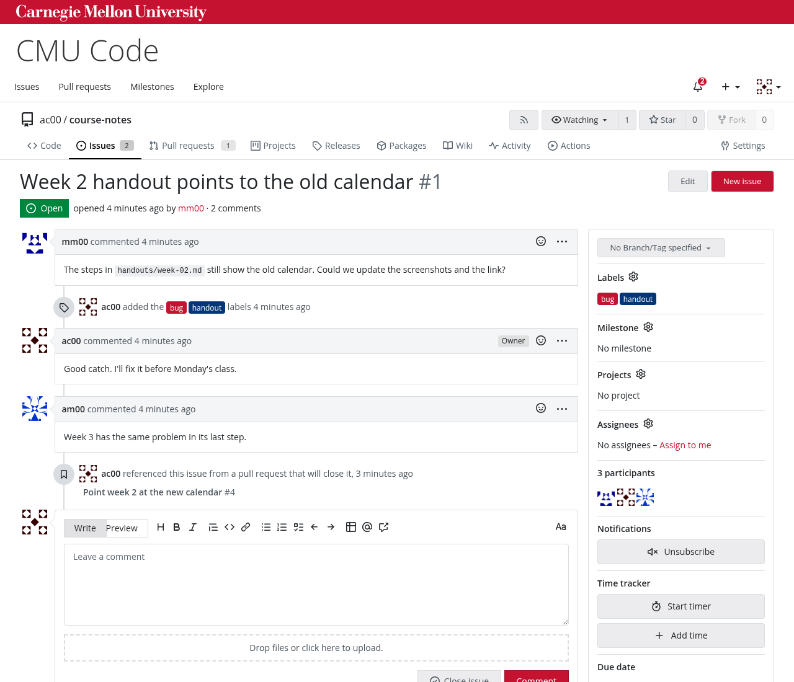

# CMU Web Forgejo Theme

A light theme for [Forgejo](https://forgejo.org/) that follows Carnegie
Mellon's web template and the
[Carnegie Mellon Web Kilt](https://webkilt.andrew.cmu.edu/0/). It adds the
template's red roof with the wordmark, the site name and the dark footer, and
turns Forgejo's own colors, corners and font into the Kilt's.



Built for Forgejo 17.0.1 and the Web Kilt 0.6.9.

## What It Changes

- **Colors:** the Kilt's red for buttons, links and the current tab; its
  grays for lines, boxes and secondary text; its callout colors for errors,
  warnings and notices.
- **Corners and font:** square corners and Open Sans, as on the template.
- **Header:** the template's red roof with the Carnegie Mellon wordmark, then
  the site name (Forgejo's `APP_NAME`), linking home. Forgejo's menu bar sits
  under it, without Forgejo's logo.
- **Footer:** the template's dark footer with the site name, the university's
  address, Legal Info and www.cmu.edu, after Forgejo's own footer line.

The header and footer use the template's own stylesheet and the Kilt's, hotlinked
and kept inside the header and footer so they can't change Forgejo's pages.
Everything else starts from Forgejo's light theme.

## Install

You need a Forgejo admin's access to its custom folder (`CustomPath`, often
`/var/lib/forgejo/custom` or, in the container, `/var/lib/gitea/custom`).

1. Copy this repository's `custom/public` and `custom/templates` into
   Forgejo's custom folder.
2. In `app.ini`, add the theme and make it the default:

   ```ini
   APP_NAME = CMU Code

   [ui]
   THEMES = cmu,forgejo-auto,forgejo-light,forgejo-dark
   DEFAULT_THEME = cmu

   [other]
   SHOW_FOOTER_TEMPLATE_LOAD_TIME = false
   ```

3. Restart Forgejo. Templates load at startup; the CSS loads on each page.

Change `APP_NAME` to your site's name. People who already picked a theme keep
it; they can switch under **Settings**, **Appearance**.

## Update the Kilt

`scripts/build.mjs` builds `custom/` from `src/`. It reads the Kilt's colors
from the pinned release on jsDelivr and adds the integrity hashes for its
stylesheets. To move to a new Kilt, change `KILT` in the script, then:

```sh
node scripts/build.mjs
```

Edit `src/`, never `custom/`, then rebuild. Commit both, so an admin can copy
`custom/` without Node.

## Look at It Locally

`dev/run.sh` runs Forgejo in Docker on 127.0.0.1 with the theme mounted, and
`dev/seed.mjs` fills it with made-up people (Andrew Carnegie, Margaret
Morrison and Andrew Mellon), three repositories, issues and a pull request.

```sh
dev/run.sh up      # http://127.0.0.1:3700/
dev/run.sh seed
dev/run.sh down
```

Sign in as `ac00` with the password in `dev/seed.mjs`. Data stays in
`dev/data`, which git ignores. Restart after a template change; a CSS change
shows on reload.


## Known Gaps

- **Light only.** The dark themes stay Forgejo's own.
- **Script for the header.** The template's rules start from `body`, which a
  header kept apart from the page doesn't have, so a short script gives it
  one. Without JavaScript, the roof shows without the wordmark.
- **Gutters.** The header's left edge and Forgejo's content are a few pixels
  apart on wide screens.
- **Avatars** are Forgejo's generated ones.
- **No menu in the roof.** The template's search and site menu aren't used;
  Forgejo's menu bar does that job.

## License

BSD 3-Clause. See `LICENSE`.
