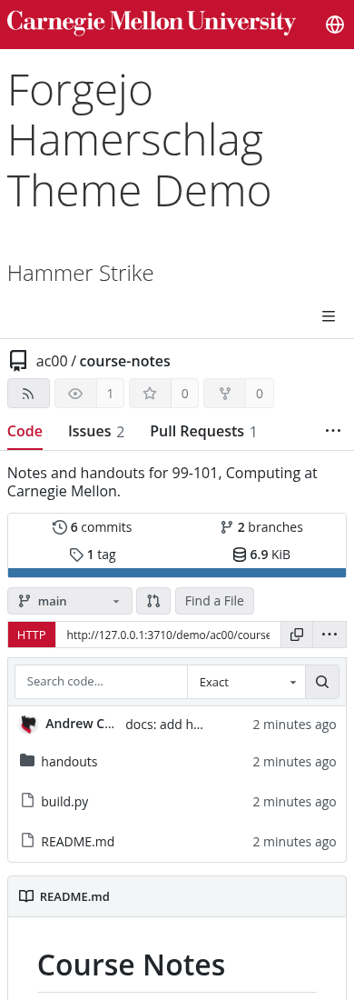

# Hamerschlag

Hamerschlag is a theme for [Forgejo](https://forgejo.org/), the code hosting
service. It gives a Forgejo site Carnegie Mellon's web template and the
[Carnegie Mellon Web Kilt](https://webkilt.andrew.cmu.edu/0/): the template's
red roof with the wordmark, your site's name and the dark footer, and the
Kilt's colors, corners, font and labels for Forgejo's own pages.

Your site keeps its own name, the one you set as `APP_NAME`. The theme never
shows its own name on your site.

It's named for Hamerschlag Hall: "Hammerschlag" is German for a hammer strike,
which suits a theme for Forgejo, whose name means "forge" in Esperanto.

The service description is at https://hamerschlag.andrew.cmu.edu/, and the
demo at https://hamerschlag.andrew.cmu.edu/demo/.


Built for Forgejo 17.0.1 and the Web Kilt 0.6.9.

## What It Changes

- **Colors:** the Kilt's red for buttons, links and the current tab; its
  grays for lines, boxes and secondary text; its callout colors for errors,
  warnings and notices.
- **Corners and font:** square corners and Open Sans, as on the template.
- **Header:** the template's red roof with the Carnegie Mellon wordmark, then
  your site's name (`APP_NAME`), linking home, with an optional line under it.
  Forgejo's menu bar sits under it, without Forgejo's logo.
- **Footer:** the template's dark footer with your site's name and the
  university's address (or your own), Legal Info and www.cmu.edu.
- **Labels:** menus, tabs and main buttons in Title Case ("Pull Requests,"
  "Find a File," "New Issue").
- **Edges:** Forgejo's side margins follow the template's, so the header,
  the page and the footer line up.
- **Default avatar:** Scotty, for deleted users and anyone Forgejo can't make
  an avatar for.

The header and footer use the template's own stylesheet, hotlinked from
cmu.edu. It loads in a cascade layer: every rule of Forgejo's wins over it,
and it's turned off outside the header and footer, so it can't change
Forgejo's pages. There's no script.

## Install

You need a Forgejo admin's access to its custom folder (`CustomPath`, often
`/var/lib/forgejo/custom` or, in the container, `/var/lib/gitea/custom`).

1. Download the latest
   [release](https://github.com/cmu-web/cmu-web-hamerschlag/releases) and copy
   its `custom/public`, `custom/templates` and `custom/options` into
   Forgejo's custom folder.
2. In `app.ini`, set your site's name, add the theme, make it the default
   and hide Forgejo's footer line:

   ```ini
   APP_NAME = Your Site's Name

   [ui]
   THEMES = hamerschlag,forgejo-auto,forgejo-light,forgejo-dark
   DEFAULT_THEME = hamerschlag

   [other]
   SHOW_FOOTER_POWERED_BY = false
   SHOW_FOOTER_VERSION = false
   SHOW_FOOTER_TEMPLATE_LOAD_TIME = false
   ```

3. Restart Forgejo. Templates and labels load at startup; the CSS loads on
   each page.

`APP_NAME` is your site's name in the header, the footer and every page
title. People who already picked a theme keep it; they can switch under
**Settings**, **Appearance**.

To add a line under your site's name (who runs it, as a link or plain text,
or a slogan), replace `custom/templates/custom/hamerschlag/site_line.tmpl`
with an `<h2>`, such as `<h2><a href="https://www.cmu.edu/">Your
Department</a></h2>`. To change the footer's address, replace
`custom/templates/custom/hamerschlag/address.tmpl`; it starts with your
site's name.

## What It Replaces in Forgejo

Check these against every Forgejo update.

- **No base templates.** The header and footer use Forgejo's own spots for
  additions, which are empty by default:
  `custom/templates/custom/header.tmpl` (the font and icons),
  `custom/templates/custom/body_inner_pre.tmpl` (the header) and
  `custom/templates/custom/footer.tmpl` (the footer), plus the theme's own
  `custom/templates/custom/hamerschlag/` (the line under your site's name and
  the footer's address). If your Forgejo already uses any of Forgejo's three,
  merge by hand.
- **Forgejo's English labels,** `custom/options/locale/locale_en-US.ini`
  and `custom/options/locale_next/locale_en-US.json`. A custom locale file
  replaces Forgejo's whole file, so these are built from the Forgejo version
  named in `scripts/build.mjs`. With another Forgejo version, rebuild them
  first (see Update the Kilt or Forgejo), or leave `custom/options` out and
  keep Forgejo's own labels.
- **The default avatar,** `custom/public/assets/img/avatar_default.png`.

## Set Up With an AI Agent

The prompt for an AI coding agent is on the service description:
https://hamerschlag.andrew.cmu.edu/#agent (its source is `site/index.html`).

## Update the Kilt or Forgejo

`scripts/build.mjs` builds `custom/` from `src/`. It reads the Kilt's colors
from the pinned Kilt release on jsDelivr, and Forgejo's English labels from
the pinned Forgejo version's source, then changes only the labels listed in
`src/locale/title-case.json`. It stops if one of them is gone. To move to a
new Kilt or Forgejo, change `KILT` or `FORGEJO` in the script, then:

```sh
node scripts/build.mjs
```

Edit `src/`, never `custom/`, then rebuild. Commit both, so an admin can copy
`custom/` without Node.

## Demo

https://hamerschlag.andrew.cmu.edu/demo/ runs Forgejo with the theme and
made-up people and projects. Like any site running the theme, it goes by its
own name, "Forgejo Hamerschlag Theme Demo," with "Hammer Strike" under it
(`demo/templates`). It's thrown away and rebuilt on every deploy from this
repository: `demo/app.ini` holds its settings and `demo/seed.mjs` its people
(Andrew Carnegie, Margaret Morrison and Andrew Mellon), repositories, issues,
a pull request and a release.

Nobody signs in. Forgejo's sign-in, sign-ups, SSH, mail, federation and
Actions are off; the seed works through a one-time admin token. The web
server in front also blocks the sign-in pages and everything but reading and
cloning: only GET and HEAD reach Forgejo, plus git's `upload-pack` for
clones. It serves the service description at the site's root and passes
`/demo/` to Forgejo with the prefix taken off. The demo uses `demo/theme-hamerschlag-demo.css`, the theme without
its Sign In links.

### Run It Locally

`dev/run.sh` runs the demo in Docker on 127.0.0.1, and `dev/site.sh` builds
the service description with a local Jekyll & Plaid checkout:

```sh
dev/site.sh        # builds site/_site
dev/run.sh up
dev/run.sh seed
dev/run.sh serve   # http://127.0.0.1:3710/ and the demo at /demo/
dev/run.sh refresh # after node scripts/build.mjs
dev/run.sh down
dev/run.sh reset   # throw the data away
```

To look at signed-in pages on your own machine, start it with `SIGNIN=1`
(`SIGNIN=1 dev/run.sh up`, then `SIGNIN=1 dev/run.sh seed`, which prints a
password for `ac00`). The hosted demo never uses it. Data stays in
`dev/data`, which git ignores.



## Known Gaps

- **Wide screens.** Above about 1,330 pixels, Forgejo's content stops growing
  before the template's header does, so their edges drift apart, up to 16
  pixels on each side.
- **Labels.** Only menus, tabs and main buttons are in Title Case. Settings
  pages and other screens still use Forgejo's sentence-case labels.
- **Avatars.** Forgejo makes a patterned avatar for each person who doesn't
  upload one. Scotty shows only for deleted users and when that fails.
- **Light only.** The dark themes stay Forgejo's own.
- **Newer browsers.** Keeping the template's styles off Forgejo's pages uses
  CSS `@scope` (Chrome and Edge 118, Safari 17.4, Firefox 146 and later). In
  older browsers a few of the template's styles show on Forgejo's pages.
- **The template's element rules.** Images, tables, video and iframes keep
  their size and alignment attributes, so the theme reverts only the
  template's own rules for them, as of `main.6.7.min.css`. Check that list in
  `src/theme-hamerschlag.css` when the template changes.
- **No menu in the roof.** The template's search and site menu aren't used;
  Forgejo's menu bar does that job.

## Service Description and Releases

`site/` is the service description, built with
[Jekyll & Plaid](https://jekyllandplaid.andrew.cmu.edu/). On a version tag,
`.github/workflows/release.yml` attaches the theme as
`hamerschlag-<version>.zip` and the built site as `site.tar.gz` to the
release.

## License

BSD 3-Clause. See `LICENSE`. The license doesn't cover Carnegie Mellon's
names, marks, Scotty artwork or web template; see `src/img/NOTICE.md`.
